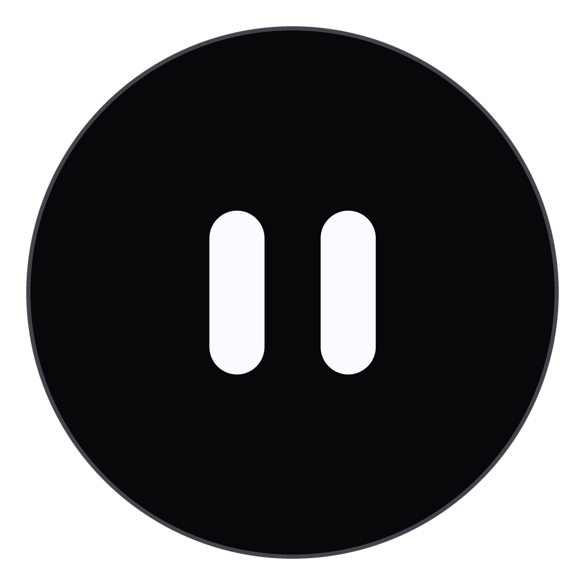

# 🏝️ TTIsland

<div align="center">



**Компактный десктоп-компаньон для музыки, ИИ-чатов и полезных инструментов**

[](LICENSE)
[](CHANGELOG.md)
[](https://www.electronjs.org/)

[Возможности](#-возможности) • [Установка](#-установка) • [Использование](#-использование) • [Скриншоты](#-скриншоты)

</div>

---

## 📖 Описание

TTIsland — это десктопное приложение на базе Electron для Windows 10/11, которое объединяет музыкальный плеер, ИИ-чаты, инструменты для записи экрана и голоса, OCR и другие полезные функции в компактном плавающем окне-острове.

### ✨ Ключевые особенности

- 🎵 **Мультиплатформенный музыкальный плеер** — Яндекс Музыка, SoundCloud, VK, Spotify
- 🤖 **ИИ-чаты** — DeepSeek, Claude, Gemini, ЯндексGPT/Алиса без API-ключей
- 🎬 **Запись экрана** — скринкаст с системным звуком, WebM формат
- 🎤 **Голосовые заметки** — офлайн-распознавание речи через Windows System.Speech
- 📸 **OCR** — распознавание текста со скриншотов без облака
- 🔊 **Управление аудио** — переключение аудиовыхода, контроль громкости
- 🔋 **Bluetooth мониторинг** — отображение заряда Bluetooth-устройств
- 🎨 **Анимированные эффекты контура** — Волны, Пульсация, Шипы, Орбита, Северное сияние
- 📋 **История буфера обмена** — отслеживание скопированного текста
- ⏱️ **Таймер и заметки** — быстрый доступ к полезным инструментам

## 🚀 Возможности

### 🎵 Музыка

- Поддержка множества платформ: Яндекс Музыка, SoundCloud, VK, Spotify
- Управление воспроизведением через MediaSession API
- Отображение обложек альбомов
- Прогресс-бар и перемотка треков
- Контроль громкости
- Компактный режим с управлением из свернутого окна

### 🤖 ИИ-ассистенты

Интеграция веб-чатов без необходимости API-ключей:
- **DeepSeek** — мощная языковая модель
- **Claude** — ассистент от Anthropic
- **Gemini** — от Google
- **ЯндексGPT/Алиса** — российские решения

### 🎬 Запись экрана и звука

- Захват экрана или отдельного окна
- Запись системного звука (Windows loopback)
- Формат WebM (VP9/VP8, до 30 FPS)
- Пауза и продолжение записи
- Локальное сохранение без загрузки в облако

### 🎤 Голосовые заметки

- Запись через микрофон (до 2 минут)
- Офлайн-распознавание через Windows System.Speech
- Сохранение и импорт WAV файлов (PCM 16 кГц/16 бит/моно)
- Прослушивание перед добавлением в заметки

### 📸 OCR и скриншоты

- Захват области экрана
- Распознавание текста без облака (использует языковые компоненты Windows)
- Поддержка русского и английского языков
- Редактирование результата перед копированием

### 🔊 Системные функции

- **Переключение аудиовыхода** — быстрая смена устройства воспроизведения
- **Мониторинг Bluetooth** — заряд подключенных устройств (гарнитуры, наушники)
- **Профили оформления** — до 20 пользовательских профилей с настройками

### 🎨 Визуальные эффекты

Анимированный контур острова с 5 режимами:
- **Волны** — геометрические смещения контура
- **Пульсация** — пульсирующее свечение
- **Шипы** — острые выступы по периметру
- **Орбита** — вращающиеся элементы
- **Северное сияние** — плавные цветовые переходы

Каждый эффект имеет настраиваемый цвет, сохраняемый в профилях.

## 📦 Установка

### Системные требования

- Windows 10 / 11
- Node.js LTS (рекомендуется последняя версия)
- Интернет для первой установки npm-зависимостей

### Быстрый старт из исходников

1. **Клонируйте репозиторий:**
   ```bash
   git clone https://github.com/yourusername/TTIsland.git
   cd TTIsland
   ```

2. **Установите зависимости:**
   ```bash
   npm install
   ```

3. **Запустите приложение:**
   - Дважды кликните `START-WINDOWS.cmd`
   - Или выполните: `npm start`

### Сборка установщика

Для создания установщика Windows (`.exe`):

1. **Запустите сборку:**
   ```bash
   npm run dist:win
   ```
   Или дважды кликните `BUILD-WINDOWS.cmd`

2. **Найдите установщик:**
   - Установщик будет создан в папке `dist/`
   - Установите приложение и запускайте TTIsland из меню Пуск

> **Примечание:** Неподписанный установщик может вызвать предупреждение SmartScreen. Это нормально для самостоятельно собранных приложений.

## 🎯 Использование

### Первый запуск

1. При первом запуске приложение откроется в развернутом режиме
2. Вы увидите главный экран с иконкой "глазки" и основными функциями
3. Для использования музыки или ИИ-чатов потребуется авторизация в соответствующих сервисах

### Управление окном

- **Alt + Space** — переключение развернутого/свернутого режима
- **Esc** — свернуть остров
- **Наведение курсора** — автоматическое раскрытие (опционально в настройках)
- **Перемещение** — зажмите область с точками слева от глаз и перетащите
- **Закрытие (×)** — скрывает в трей, приложение продолжает работать
- **Выход** — через трей или "Выйти из приложения" в настройках

### Музыка

1. На главной странице нажмите стрелку рядом с названием сервиса
2. Выберите платформу: Яндекс / SoundCloud / VK / Spotify
3. Нажмите "Войти / открыть" для авторизации
4. Используйте кнопки управления в шапке острова

### Запись экрана

1. Откройте "Скринкаст" или "Запись экрана" на главной
2. Выберите экран или окно по миниатюре
3. Включите системный звук (опционально)
4. Нажмите "Начать запись" и выберите файл сохранения
5. Используйте красную кнопку в шапке для остановки

### Голосовые заметки

1. Перейдите в раздел "Заметки"
2. Нажмите "Записать" и разрешите доступ к микрофону
3. Говорите (до 2 минут)
4. Нажмите "Стоп", затем "Распознать"
5. Проверьте текст и нажмите "В заметки"

### OCR

1. Главная → "Снимок экрана"
2. В редакторе нажмите "Область OCR"
3. Выделите прямоугольник с текстом
4. Выберите язык и нажмите "Распознать текст"
5. Скопируйте результат

### Профили оформления

1. Настройки → Профили оформления
2. Выберите готовый профиль или создайте свой
3. Настройте цвета эффектов, анимации и быстрые кнопки
4. Профиль сохранится автоматически

## 📸 Скриншоты

> **Примечание:** Добавьте скриншоты в папку `assets/screenshots/` и обновите ссылки ниже

### Главный экран

*Развернутый остров с музыкальным плеером и основными функциями*

### Компактный режим

*Свернутый остров с управлением музыкой*

### Эффекты контура

*Анимированные эффекты: Волны, Шипы, Северное сияние*

### Запись экрана

*Интерфейс записи экрана с выбором источника*

### ИИ-чаты

*Интеграция DeepSeek, Claude, Gemini*

## ⚙️ Настройки

### Размер и положение

- Настройки → Размер и положение
- Настройка ширины развернутого и свернутого острова
- Настройка высоты виджета
- Сброс положения окна

### Вибрация контура

- Выбор эффекта: Волны / Пульсация / Шипы / Орбита / Северное сияние / Выключено
- Настройка цвета для каждого эффекта
- Предпросмотр работает 8 секунд

### Анимации

- Полные (все анимации включены)
- Как в системе (следует настройкам Windows)
- Выключены (статичный интерфейс)

## 🔧 Технические детали

### Архитектура

- **Фронтенд:** HTML, CSS, JavaScript (ES modules)
- **Бэкенд:** Electron, Node.js
- **Нативные модули:** PowerShell скрипты для Windows API
- **Форматы:** WebM (видео), WAV (аудио), PNG (скриншоты)

### Используемые технологии

- **Electron 42.0** — кроссплатформенный фреймворк
- **Windows Core Audio** — управление аудиовыходом
- **Windows System.Speech** — офлайн-распознавание речи
- **WinRT API** — Bluetooth и системная интеграция
- **MediaRecorder API** — запись экрана
- **MediaSession API** — управление медиа

### Папки проекта

```
TTIsland/
├── assets/              # Иконки и ресурсы
├── native/              # Нативные PowerShell модули
├── index.html           # Главный HTML файл
├── main.cjs             # Главный процесс Electron
├── preload.cjs          # Preload скрипты
├── music-*.js/cjs       # Музыкальные адаптеры
├── recording.cjs        # Запись экрана
├── voice.cjs            # Голосовые заметки
├── desktop-tools.cjs    # Системные инструменты
├── plus.js/css          # Дополнительные функции
├── extras.js/css        # Расширенные возможности
├── package.json         # NPM конфигурация
├── LICENSE              # MIT лицензия
└── README.md            # Этот файл
```

## 🔒 Безопасность и конфиденциальность

- **Локальное хранение:** Все записи, заметки и настройки хранятся локально
- **Нет облачной отправки:** Скриншоты, записи и аудио не загружаются на сторонние серверы
- **Изолированные сервисы:** Веб-страницы сервисов не имеют доступа к файловой системе
- **Защищенные cookies:** Отдельное хранилище для каждого сервиса
- **Офлайн OCR:** Распознавание текста через Windows API без интернета

> **Важно:** История буфера обмена хранится локально без шифрования. Не копируйте секреты при включенной истории.

## 🐛 Известные ограничения

- **Windows only:** Приложение разработано только для Windows 10/11
- **Bluetooth:** Заряд доступен не для всех устройств, зависит от драйвера
- **DRM контент:** Защищенный контент может не воспроизводиться в Spotify/других сервисах
- **Google аккаунты:** Вход из встроенного браузера может быть ограничен Google
- **MP3/M4A:** Голосовые заметки поддерживают только WAV формат
- **Администратор:** Не требуется, но некоторые функции могут быть ограничены политиками организации

## 📋 Обновление

1. **Полностью выйдите** из приложения через трей
2. **Замените все файлы** в папке, включая:
   - `extras.js`, `extras.css`
   - `desktop-tools.cjs`
   - Папку `native/`
3. **Запустите** `START-WINDOWS.cmd` или `npm start`
4. **Для установленного EXE:** Пересоберите через `BUILD-WINDOWS.cmd`

> Настройки и сессии сервисов сохраняются в профиле `island-lab` и не удаляются.

## 🗺️ Roadmap

См. [ROADMAP.md](ROADMAP.md) для списка планируемых функций.

## 📝 История изменений

Подробная история версий доступна в [CHANGELOG.md](CHANGELOG.md).

## 📄 Лицензия

Этот проект распространяется под лицензией MIT. См. файл [LICENSE](LICENSE) для подробностей.

Сторонние компоненты и их лицензии перечислены в [THIRD-PARTY-NOTICES.md](THIRD-PARTY-NOTICES.md).

## 🤝 Благодарности

- Иконка "глазки" — оригинальный дизайн TTIsland
- Electron — за кроссплатформенный фреймворк
- Сообщество разработчиков Windows API

---

<div align="center">

**Сделано с ❤️ для удобства и продуктивности**

[⬆ Вернуться наверх](#️-ttisland)

</div>

