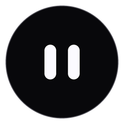
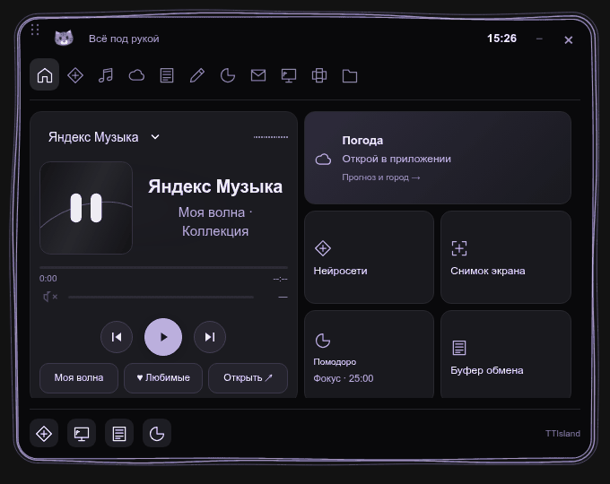
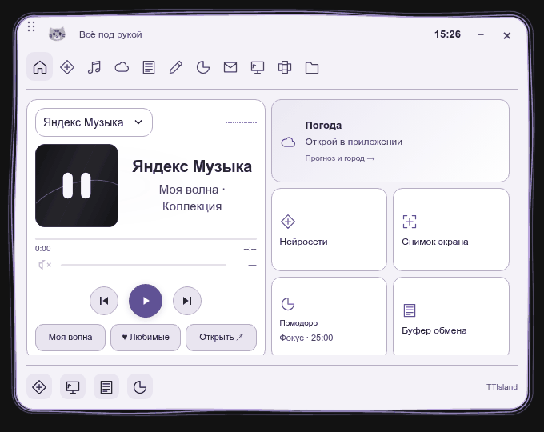
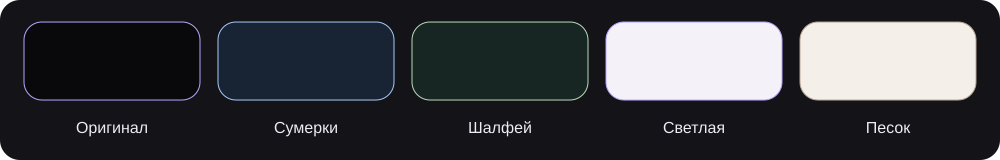
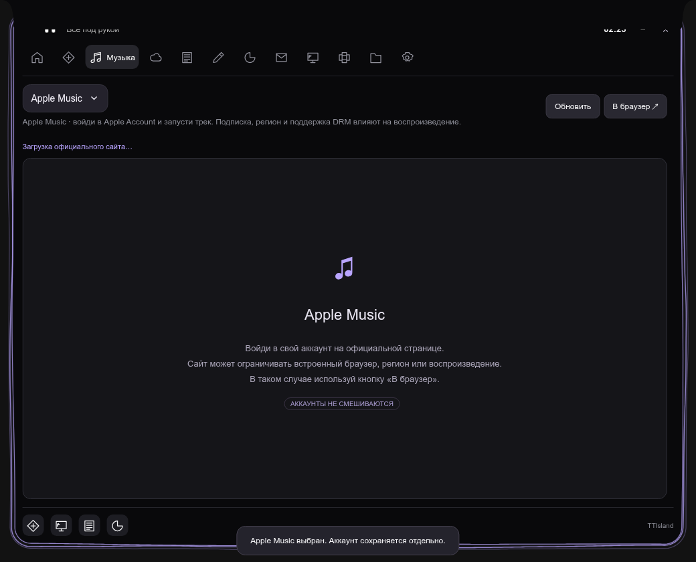
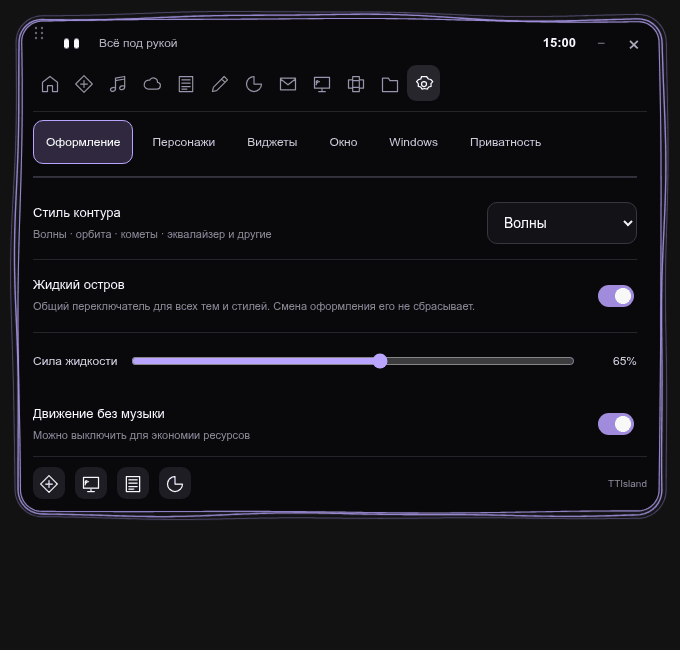

<div align="center">



# TTIsland

### Меньше окон. Больше фокуса.

Музыка, нейросети и повседневные инструменты — в одном живом острове на рабочем столе Windows.

[](CHANGELOG-0.17.0-rc.3-RU.md)
[](#установка)
[](https://github.com/danyaborisoff-collab/TTIsland/actions/workflows/windows-release.yml)
[](LICENSE)

**[Скачать установщик](https://github.com/danyaborisoff-collab/TTIsland/releases/tag/v0.17.0-rc.3)** · **[Возможности](#возможности)** · **[Запуск из исходников](#запуск-из-исходников)** · **[Что нового](#что-нового-в-0170-rc3)**



*Твой маленький центр управления. Открыл, сделал нужное — вернулся к своим делам.*

</div>

> **Текущая версия: 0.17.0-rc.3 — предварительный выпуск для Windows x64.** Сборка и публикация выполняются в [GitHub Actions](https://github.com/danyaborisoff-collab/TTIsland/actions/workflows/windows-release.yml). После успешных проверок установщик появится в [Releases](https://github.com/danyaborisoff-collab/TTIsland/releases/tag/v0.17.0-rc.3). Это неподписанный установщик; проверка на реальном Windows-ПК по-прежнему нужна.

---

## Большой рабочий день. Маленький остров.

Начинается трек. Нужно поставить паузу — а плеер где-то за окнами. Пришла мысль — пора искать заметки. Понадобился ответ нейросети — ещё одна вкладка. Короткое действие незаметно превращается в путешествие по рабочему столу.

**TTIsland собирает эти маленькие действия в одном месте.**

В компактном состоянии остров оставляет под рукой музыку и самое важное. В развёрнутом — становится панелью с виджетами, сервисами и инструментами. Его можно переместить, настроить под свой ритм и спрятать в трей, когда он не нужен.

Не ещё один большой рабочий стол внутри рабочего стола. Скорее — короткий путь обратно к тому, что ты делал.

## Взгляни на остров

<table>
  <tr>
    <td width="50%" align="center"><strong>Ночной ритм</strong></td>
    <td width="50%" align="center"><strong>Светлая сторона</strong></td>
  </tr>
  <tr>
    <td></td>
    <td></td>
  </tr>
</table>

<p align="center">
  
</p>

*Изображения из репозитория показывают интерфейс и варианты оформления. Это не подтверждение работы реальных аккаунтов или всех функций Windows; отдельные детали могут отличаться от 0.17.0-rc.3.*

## Возможности

### Музыка, которая остаётся рядом

Не обязательно возвращаться в большое окно музыкального сервиса ради одной кнопки.

- **Яндекс Музыка, SoundCloud, VK Музыка и Apple Music** — выбор сервиса в интерфейсе.
- Воспроизведение, пауза и переключение треков; прогресс, громкость и перемотка — когда сервис предоставляет нужные возможности.
- Компактный плеер с информацией о треке и обложкой, если эти данные доступны.
- Для Яндекс Музыки — быстрые действия «Моя волна» и «Любимые».
- Отдельные сессии входа для музыкальных провайдеров.

Сервисы открываются на своих официальных сайтах внутри приложения. TTIsland не заменяет подписку, не скачивает защищённые треки и не обходит DRM. Управление зависит от сайта; при ограничениях встраивания есть кнопка **«В браузер»**.

<details>
<summary><strong>Посмотреть панель Apple Music</strong></summary>



*На снимке — интерфейс панели до загрузки сервиса, а не воспроизводящий музыку аккаунт.*

Подробнее о входе, подписке и ограничениях: [Apple Music в TTIsland](APPLE-MUSIC-RU.md).

</details>

### Нейросети — без охоты за вкладками

**DeepSeek · Claude · Gemini · ЯндексGPT / Алиса**

Открой нужный веб-чат прямо в острове и войди в свой аккаунт. Для этого режима не нужны API-ключи: это официальные сайты, а не собственный сервер моделей TTIsland.

У каждого сервиса сохраняются его подписки, лимиты, правила входа и региональные ограничения. Удалённым страницам не выдаётся прямой доступ к файловой системе и привилегированным командам приложения.

### Главная, собранная под тебя

Одному нужен плеер и погода. Другому — заметки, таймер и быстрый снимок экрана.

В настройках главного экрана можно **добавлять и убирать блоки, менять их порядок и размер**. Раскладка сохраняется локально; для возвращения к началу есть сброс.

Погода умеет открывать подробный прогноз с поиском города, почасовыми данными и доступными показателями Open-Meteo. Поиск и прогноз требуют интернета; название города и координаты передаются сервису. При ошибке приложение показывает состояние ошибки, а не придумывает погоду.

### Маленькие инструменты для настоящих дел

| Инструмент | Для чего он здесь |
| :--- | :--- |
| **Заметки** | Быстро сохранить мысль и не переключать контекст. |
| **Помодоро** | Выделить время на задачу и видеть таймер рядом. |
| **История буфера** | Вернуться к недавно скопированному тексту; автоматический сбор включается в настройках. |
| **Снимок экрана** | Сделать снимок, добавить пометки, сохранить PNG или скопировать изображение. |
| **OCR** | Выделить область снимка и распознать текст средствами Windows; нужны подходящие языковые компоненты. |
| **Скринкаст** | Записать экран; доступность системного звука и захвата зависит от Windows и разрешений. |
| **Голосовые заметки** | Записать голос, прослушать и сохранить WAV; распознавание зависит от установленного Windows System.Speech. |
| **Почта** | Проверять число непрочитанных через IMAP и получать уведомления — не полноценный почтовый клиент. |
| **Система и устройства** | Панели Wi-Fi, звука, Bluetooth и дисплеев; часть действий выполняется через штатные окна Windows. |

Системные возможности относятся к настольной версии. Открытый в браузере `index.html` — только интерфейсный предпросмотр, а не замена приложению.

### Не просто рамка. Характер.

У острова есть собственное настроение: персонажи, темы, цвет и движение контура.

- **Волны, пульсация, шипы, орбита, северное сияние, кометы, эквалайзер, кольца, кипящая вода и искры.**
- Цвет контура для выбранного эффекта и готовые цветовые варианты.
- Общий переключатель жидкой поверхности для тем.
- Персонажи острова, включая глазки, котика, призрака, Лучика и Цветика.
- Настройка размеров, положения и режима поверх других окон.
- Управление анимациями, в том числе режим с учётом системных настроек.

Декоративная анимация сама по себе **не означает анализ музыки**. Реакция на системный звук требует отдельного включения анализа.

<details>
<summary><strong>Посмотреть настройки жидкой поверхности</strong></summary>



</details>

## Один день с TTIsland

**Утро.** Выбираешь музыку, оставляешь на главной погоду и задачи. Остров занимает своё место у края рабочего пространства.

**Работа.** Запускаешь помодоро. Пришла мысль — записываешь. Нужен текст со снимка — открываешь OCR. Нужен веб-чат — переключаешь сервис, не разыскивая его среди вкладок.

**Пауза.** Меняешь трек из компактного плеера. Выбираешь другую тему, если хочется сменить настроение.

**Вечер.** Прячешь остров в трей. Чтобы завершить приложение, выбираешь «Выйти полностью» — обычное закрытие окна оставляет его работать в фоне.

## Установка

### Готовый установщик Windows x64

1. Открой **[релиз 0.17.0-rc.3](https://github.com/danyaborisoff-collab/TTIsland/releases/tag/v0.17.0-rc.3)** после завершения [сборки](https://github.com/danyaborisoff-collab/TTIsland/actions/workflows/windows-release.yml).
2. В разделе **Assets** скачай **[`TTIsland-0.17.0-rc.3-Setup-x64.exe`](https://github.com/danyaborisoff-collab/TTIsland/releases/download/v0.17.0-rc.3/TTIsland-0.17.0-rc.3-Setup-x64.exe)**.
3. Полностью выйди из старой версии через трей и запусти установщик. Node.js для установки не нужен.

Вручную к релизу прикрепляется только **один `.exe`**, без ZIP с установщиком, JSON-отчётов и служебных файлов. Контрольная сумма SHA-256 приведена в описании релиза. GitHub также автоматически показывает стандартные архивы исходников.

> **Важно:** установщик не имеет цифровой подписи, поэтому Windows может показать предупреждение SmartScreen. Проверяй источник файла и контрольную сумму; отключать защиту Windows не требуется.

Это обычная сборка Electron. Наличие панели Apple Music не гарантирует воспроизведение защищённой музыки: для Widevine требуется отдельная castlabs-сборка и её настройка, описанная в `START-WINDOWS-DRM.cmd` и `BUILD-WINDOWS-DRM.cmd`. В опубликованном EXE DRM-воспроизведение не заявляется.

### Запуск из исходников

Нужны Windows и **Node.js 20+ с npm**; для первого запуска — интернет для установки зависимостей. В CI используется Node.js 22.

```bash
git clone https://github.com/danyaborisoff-collab/TTIsland.git
cd TTIsland
```

Затем запусти **`START-WINDOWS.cmd`**. Скрипт проверит Node.js, при необходимости установит зависимости и откроет приложение.

Вручную:

```bash
npm install
npm start
```

Для сборки собственного установщика — **`BUILD-WINDOWS.cmd`**. Готовые файлы появляются в `dist/`.

**Обновление:** сначала полностью выйди из прежней версии через трей. При использовании исходников распакуй новую версию в отдельную папку. Не смешивай файлы разных выпусков.

## Управление без лишних движений

| Действие | Как выполнить |
| :--- | :--- |
| Показать остров | `Alt + Space` или значок в трее. Сочетание может быть занято другой программой. |
| Свернуть панель | `Esc` или кнопка сворачивания. |
| Переместить остров | Потянуть за область точек в шапке. |
| Открыть настройки | Вкладка настроек или `Ctrl + ,`. |
| Скрыть окно в трей | Крестик окна или `Alt + F4`. |
| Завершить приложение | «Выйти полностью» в трее или «Выйти из приложения» в настройках. |

## Что нового в 0.17.0-rc.3

- **Жидкие эффекты:** прилипание к верхнему краю экрана, расширенная верхняя кромка и капли; отдельные настройки силы эффектов.
- **Хаос контура:** ползунок 0–100 % меняет поведение волн, шипов, эквалайзера и других эффектов, с коротким предпросмотром без музыки.
- **Спокойнее персонажи:** удалены случайные трюки и «хаос» персонажей; минималистичные белые глазки и скорость родных анимаций 25–400 %.
- **Apple Music:** обновлены обработка разрешений и сообщения об отсутствии DRM; обычная Electron-сборка не включает подтверждённое Widevine-воспроизведение.
- **Установка:** отдельный Windows x64 EXE в Releases вместо загрузки архива артефактов Actions.

Проверки интерфейса в Chromium не заменяют проверку реальных устройств, аккаунтов и поведения Electron в Windows. Сборка публикуется как **prerelease**, а не стабильная версия.

[Изменения rc.3](CHANGELOG-0.17.0-rc.3-RU.md) · [rc.2](CHANGELOG-0.17.0-rc.2-RU.md) · [rc.1](CHANGELOG-0.17.0-rc.1-RU.md)

## Что важно знать

<details>
<summary><strong>Приватность, аккаунты и системные ограничения</strong></summary>

- **Аккаунты сервисов.** Вход выполняется на официальных страницах провайдеров. Их доступность, подписки, лимиты и DRM TTIsland не отменяет.
- **Буфер обмена.** История хранится локально и может содержать пароли или другие секреты. Автоматический сбор включается отдельно; историю можно очистить.
- **Почта.** Для IMAP может понадобиться пароль приложения. Его сохранение использует защищённое хранилище Electron; если шифрование недоступно, приложение отказывается сохранять пароль.
- **Голос и OCR.** Возможности зависят от компонентов и языковых пакетов Windows. Русский интерфейс системы не гарантирует наличие русского движка диктовки.
- **Bluetooth.** Статус и заряд зависят от устройства и драйвера. Отдельный заряд кейса или каждого наушника не гарантируется.
- **Запись экрана.** Нужны системные разрешения. Захват защищённого контента и звука конкретного приложения не гарантируется.
- **Снимки переходов.** Кадры встроенного сайта для анимации rc.8 существуют в памяти.
- **Статус проекта.** Это самостоятельный экспериментальный проект, не официальный клиент музыкальных сервисов, нейросетей или других продуктов со схожим названием.

</details>

## Как устроен остров

**Electron + JavaScript + CSS + Canvas**, а для системных возможностей Windows — нативные помощники на PowerShell и C#.

```text
TTIsland/
├── index.html                 # Интерфейс и основные разделы
├── main.cjs / preload.cjs     # Electron и мост к системным функциям
├── music-*.js / music-*.cjs   # Музыкальные сервисы и управление
├── provider-controller.cjs   # Каталог и открытие сервисов
├── motion.js / contour.js    # Переходы и живой контур
├── native/                   # Windows-помощники
├── assets/                   # Значки и ресурсы
├── docs/                     # Скриншоты, документация и отчёты
└── tests/                    # Проверки интерфейса и логики
```

Для базовых проверок выпуска:

```bash
npm run test:release
npm run check:windows
```

Некоторым тестам нужен браузер Playwright; Windows-проверкам — Windows. Дополнительные команды для музыки, компактного плеера и переходов перечислены в [package.json](package.json). Автоматические проверки не подтверждают работу всех реальных аккаунтов и устройств.

## История и документация

История TTIsland — это движение от музыкального виджета и веб-чатов к настраиваемой панели с собственным визуальным характером: инструменты Windows, жизнь в трее, темы, виджеты и работа над плавностью переходов.

Главная страница теперь рассказывает о приложении, а технические детали остаются на своих местах:

- **[Архив прежнего README](docs/README-HISTORY-RU.md)** — сохранённый целиком журнал заметок и предыдущих версий.
- **[Общий журнал изменений](CHANGELOG.md)** — история проекта.
- **[Последний выпуск: 0.16.3-rc.8](CHANGELOG-0.16.3-rc.8-RU.md)** — изменения и известные ограничения.
- **[Подготовка Windows-релиза](GITHUB-RELEASE-RU.md)** — процесс сборки и выпуска.
- **[Дорожная карта](ROADMAP.md)** — дальнейшие идеи.
- **[Сторонние компоненты](THIRD-PARTY-NOTICES.md)** и **[лицензия MIT](LICENSE)**.

Если заметил проблему, [создай issue](https://github.com/danyaborisoff-collab/TTIsland/issues/new): укажи версию, Windows, шаги воспроизведения и ожидаемый результат. Видео особенно полезно для рывков и мерцания. Не прикладывай пароли, токены и личные данные.

---

<div align="center">

**TTIsland — всё нужное рядом. Остальное пространство — твоё.**

Сделано для рабочего стола, который хочется оставить своим.

</div>
